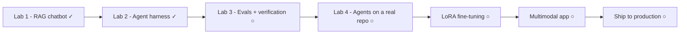

If [Foundations]() explained the pieces and
[Building]() showed the architectures, **Stage 3** is where you
type. Every lab is incremental: each step runs and is verified before the next begins,
because that's how production systems actually grow.

## Roadmap

## The labs

1. [Lab 1 — RAG chatbot on your own documents]() ✓
   — infra → ingestion → keyword search → hybrid → full RAG → monitoring + cache → agentic.
2. [Lab 2 — Build your own agent harness]() ✓
   — one API call → one tool → the loop → context management → subagents → a model per role →
   permissions and hooks → MCP and the Agent SDK, checked against Claude Code at every step.
3. ○ **Lab 3 — an eval harness + observability** for labs 1–2, plus **verifying what an agent
   produces**: tests as the oracle, diff review, LLM-as-judge.
4. ○ **Lab 4 — agents on a real repo, Level 1 → 3.** Make a repository agent-ready (CLAUDE.md,
   one-command tests, lint), spec and verify one tech-debt task, run three solutions in parallel
   in git worktrees scored on the same criteria, then orchestrate a headless run and measure
   before/after — the demo that shows colleagues an agent is more than a chatbot.
5. ○ **Practical fine-tuning (LoRA)** — adapt a small model for tone and schema.
6. ○ **A multimodal app** — vision input, document extraction.
7. ○ **Ship to production** — deployment, cost control, monitoring.

## Prerequisites

Work through the matching [thread]() of
Stages 0–2 first — the RAG thread for Lab 1, the Agents thread for Labs 2 and 4. The labs assume
the concepts and reference them instead of re-explaining.
