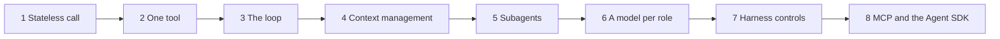

## Goal

Using Claude Code every day teaches you *what* an agent does. This lab teaches you *why*, by
building the same machine yourself. Six ideas carry the whole field:

- **Tool use**: how a model acts on files, terminals and other systems.
- **The agentic loop**: reason, act, observe, repeat.
- **Context management**: keeping the window useful as it fills.
- **Subagents**: delegating independent work to a fresh context.
- **Model selection**: trading capability against speed and cost.
- **The harness**: the runtime, permissions and controls around all of it.

They are not six separate topics. They are six views of **one loop**, and each one exists
because of a problem the previous one creates:



You build one Python file, `agent.py`, in that order. It ends at about 200 lines. After every
step you look at **the same mechanism inside Claude Code**, using its own traces, so the tool you
use daily becomes something you can read instead of a black box.

The finished code, with offline tests, is in [`labs/agent-harness/`](https://github.com/namphuongtran/ai-vault/tree/main/labs/agent-harness) in this vault's
repository. Read it after you have written your own version, not before.

**Prerequisites:**

- Python 3.11+ and an Anthropic API key.
- Claude Code installed.
- In a virtual environment: `pip install anthropic "mcp>=2.3" claude-agent-sdk pytest`. Keep it
  activated, so the agent's shell finds `pytest` too.
- The concepts from the [Agents thread]().
  This lab links the theory instead of repeating it.

**Pace:** one step per week is a good rhythm, which makes the whole lab two months of evenings.
The point is not to finish. The point is to break each step on purpose before you move on.

## How each step works

Each step is one page with the same shape:

1. **The question** at the top. You should be able to answer it by the end of the page.
2. **Build**: only what is new in `agent.py`.
3. **Check**: what you should see when it works.
4. **See it in Claude Code**: where the same mechanism shows up in the tool you already use.
5. **Break it**: one deliberate failure. Most of the learning happens here.
6. **Answer**: try your own answer before you read it.

## The project

The agent works on a tiny project with two files and two bugs:

```python
# sandbox/calc.py
def average(xs):
    return sum(xs) / len(xs) - 1
```

```python
# sandbox/test_calc.py
from calc import average

def test_average():
    assert average([2, 4]) == 3

def test_empty_list_is_zero():
    assert average([]) == 0
```

## The eight steps

| Step | You build | You see in Claude Code |
| --- | --- | --- |
| [1 — A stateless call]() | A chat loop over a message list you keep | Session transcripts in `~/.claude/projects/` |
| [2 — One tool]() | One `tool_use` → `tool_result` round trip by hand | `/context` and the cost of tool definitions |
| [3 — The loop]() | Four tools, parallel calls, errors as results, `max_turns` | A `PostToolUse` hook log; `stream-json` output |
| [4 — Context management]() | Clipping, just-in-time reads, `AGENT.md`, caching, compaction | `/context`, `/compact`, CLAUDE.md, `tool-results/` |
| [5 — Subagents]() | `delegate()`: a fresh `run()` with fewer tools | `.claude/agents/*.md` and `subagents/` transcripts |
| [6 — A model per role]() | Traces and a benchmark across models and effort | `/model` and `model:` in subagent files |
| [7 — Harness controls]() | Permission rules, hooks, saved sessions | `allow` / `ask` / `deny`, permission modes, `--resume` |
| [8 — Plug-ins, and the real thing]() | An MCP server, then the agent on the Agent SDK | `claude mcp add`, `/mcp` |

## Debug any agent with four questions

From now on, when Claude Code or your own agent goes wrong, open the trace, find the **first**
turn where it went off course, and ask in order:

1. **Missing context?** It didn't know something it needed, or the thing it needed was buried.
   Go back to [step 4]().
2. **Bad tool?** The description misled it, the output was too big, or an error was swallowed.
   Go back to [steps 2]() and [3]().
3. **Weak model?** It had the facts and the tools and still reasoned badly. Go back to [step 6]().
4. **Missing harness constraint?** It did something it should never have been *able* to do.
   Go back to [step 7]().

Most failures that look like "the model is dumb" turn out to be the first two.

## Where this setup tops out

- **This is Level 1**, one agent working for one person. Running many agents on a real codebase,
  with parallel work in isolated git worktrees, orchestration and review, is **Lab 4**.
- **Nothing here checks that the output is *good*.** Passing tests are one signal. Evaluating
  what an agent produces is **Lab 3**.
- **Regex permissions are not a sandbox.** For anything you didn't write yourself, run the agent
  in a container with no credentials.
- In production you would use the platform's server-side compaction and context editing rather
  than `compact()`. Building `compact()` by hand is how you learn what those do.

## Sources

- [Anthropic — Building effective agents](https://www.anthropic.com/research/building-effective-agents)
- [Anthropic — Effective context engineering for AI agents](https://www.anthropic.com/engineering/effective-context-engineering-for-ai-agents)
- [Anthropic — Writing effective tools for AI agents, using AI agents](https://www.anthropic.com/engineering/writing-tools-for-agents)
- [Anthropic — How we built our multi-agent research system](https://www.anthropic.com/engineering/multi-agent-research-system)
- [Anthropic — Building agents with the Claude Agent SDK](https://www.anthropic.com/engineering/building-agents-with-the-claude-agent-sdk)
- [Anthropic — Effective harnesses for long-running agents](https://www.anthropic.com/engineering/effective-harnesses-for-long-running-agents)
- Thorsten Ball, [How to Build an Agent](https://ampcode.com/how-to-build-an-agent) (Amp) · [mini-swe-agent](https://github.com/SWE-agent/mini-swe-agent)
- Liu et al., *Lost in the Middle: How Language Models Use Long Contexts* (2023) — [arXiv:2307.03172](https://arxiv.org/abs/2307.03172)
- [Chroma — Context Rot](https://research.trychroma.com/context-rot) · [Cognition — Don't Build Multi-Agents](https://cognition.ai/blog/dont-build-multi-agents)
- Claude API docs: [Tool use](https://platform.claude.com/docs/en/agents-and-tools/tool-use/overview) · [Prompt caching](https://platform.claude.com/docs/en/build-with-claude/prompt-caching) · [Compaction](https://platform.claude.com/docs/en/build-with-claude/compaction)
- Claude Code docs: [Sessions](https://code.claude.com/docs/en/sessions) · [The .claude directory](https://code.claude.com/docs/en/claude-directory) · [Hooks](https://code.claude.com/docs/en/hooks) · [Subagents](https://code.claude.com/docs/en/sub-agents) · [Permissions](https://code.claude.com/docs/en/permissions) · [Headless mode](https://code.claude.com/docs/en/headless) · [MCP](https://code.claude.com/docs/en/mcp) · [Agent SDK for Python](https://code.claude.com/docs/en/agent-sdk/python)
- [MCP Python SDK](https://github.com/modelcontextprotocol/python-sdk)
