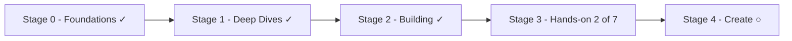

This vault is a **living map**, not a finished book. The goal is to go beyond *using*
ChatGPT or Claude: **understand** how these systems work, **master** the techniques that
matter, **build** real systems, and eventually **ship** hands-on projects. Written pages are
marked ✓; planned ones ○ — they get filled in as I learn.

## The journey

Read **across** to progress stage by stage, or pick a row in the
[threads table](#follow-one-topic-in-depth) below to go deep on one topic. To check what you
can actually *do*, use the [25-skill checklist](#the-25-skill-checklist).

## Stage 0 — Foundations ✓

28 concepts in [five ordered modules](), from *what models are*
to *operating them in production*:

1. **Understand** — the landscape, generative AI, foundation models, how LLMs work, training,
   multimodality, limitations.
2. **Work with a model** — the API, parameters, prompting, context, structured outputs,
   reasoning models, cost, choosing a model.
3. **Ground it in your data** — embeddings, RAG.
4. **Make it act** — tools, agents, agentic AI, MCP, AI coding assistants.
5. **Operate & govern** — guardrails, security, evaluation, observability, responsible AI.

## Stage 1 — Deep Dives ✓

[Twelve dives]() along the same spine:
[prompt patterns]() ·
[vector databases]() ·
[types of RAG]() ·
[advanced RAG]() ·
[agent patterns]() ·
[agent memory]() ·
[multi-agent systems]() ·
[self-improving agents]() ·
[computer use]() ·
[adaptation]() ·
[evaluation in practice]() ·
[RAG evaluation]().

## Stage 2 — Building with AI ✓

[Ten entries]() that assemble the pieces:
[AI system design]() ·
[scaling to production]() ·
[serving models]() ·
[building RAG]() ·
[agentic RAG]() ·
[the agent harness]() ·
[loop engineering]() ·
[from prompts to graphs]() ·
[AI code structure]() ·
[tooling & frameworks]().

## Stage 3 — Hands-on (in progress)

[Real projects](), built incrementally:

1. ✓ **[Lab: a RAG chatbot over my own documents]()**
   — in seven steps: infrastructure → ingestion → keyword search → hybrid search → full RAG →
   monitoring + caching → agentic upgrade.
2. ✓ **[Lab: build your own agent harness]()** — in eight steps: one API call → one tool →
   the loop → context management → subagents → a model per role → permissions and hooks → MCP and
   the Agent SDK, each checked against Claude Code.
3. ○ **Lab: an eval harness + observability** for labs 1–2, plus verifying what an agent produces.
4. ○ **Lab: agents on a real repo, Level 1 → 3** — agent-ready repo, spec and verify, parallel
   solutions in git worktrees, orchestration, before/after measurement.
5. ○ **Practical fine-tuning (LoRA)** — adapt a small model for tone and schema.
6. ○ **A multimodal app** — vision input, document extraction.
7. ○ **Ship to production** — deployment, cost control, monitoring.

## Stage 4 — Create ○ (planned, further out)

- ○ AI product design — from capability to product.
- ○ The economics of experimentation — from *"do we have the people and time to build this?"* to
  *"can we run an experiment to find out whether it's worth building?"* Cheap experiments still
  need a hypothesis, a success metric, a kill criterion and a budget **before** you delegate
  them, because more output is not more value.
- ○ Case studies of real AI products.
- ○ Certification notes & review sheets.

## Follow one topic in depth

Each row is one thread through all stages — the vertical way to read the vault:

| Thread | Stage 0 | Stage 1 | Stage 2 | Stage 3 ○ |
| ------ | ------ | ------ | ------ | ------ |
| **Prompts** | [Prompt engineering]() · [Context engineering]() | [Prompt patterns]() | — | — |
| **Data & RAG** | [Embeddings]() · [RAG]() | [Vector databases]() · [Types of RAG]() · [Advanced RAG]() · [RAG evaluation]() | [Building RAG]() · [Agentic RAG]() | [RAG chatbot lab ✓]() |
| **Agents** | [Tool calling]() · [Agents]() · [Agentic AI]() · [MCP]() | [Agent patterns]() · [Agent memory]() · [Multi-agent]() · [Self-improving]() · [Computer use]() | [Agent harness]() · [Loop engineering]() · [AI code structure]() | [Agent harness lab ✓]() · ○ Real-repo lab |
| **Operate** | [Guardrails]() · [AI security]() · [Evaluation]() · [Observability]() · [Responsible AI]() | [Adaptation]() · [Evaluation in practice]() · [RAG evaluation]() | [AI system design]() · [Scaling to production]() · [Tooling & frameworks]() | ○ Evals + ship lab |
| **Serving & inference** | [The AI API]() · [Cost & tokens]() · [Choosing a model]() | [Adaptation]() | [Scaling to production]() · [Serving models]() | ○ Ship to production lab |

## Agent engineering — four layers

Opening Claude Code, writing prompts or adding a skill file is not the same as understanding
agents. The skill stacks in four layers, and each one needs the layer below it:

| Layer | The question it answers | In the vault |
| --- | --- | --- |
| **Mechanics** | How does an agent work? Context management, tool use, subagents, model selection, the loop, the harness. | [Agents thread](#follow-one-topic-in-depth) · [Lab 2 ✓]() |
| **Craft** | How do I get work I can *trust*? An agent-ready repo, a clear spec, and verification of the output. | ○ Lab 3 · ○ Lab 4 |
| **Scale** | How do I go from one agent to many? Level 1 one agent → Level 2 parallel subagents → Level 3 an orchestrator while you own goals and decisions. | [Multi-agent]() · [Fleet looping]() · ○ Lab 4 |
| **Judgment** | What is worth building, and did it work? Experiments with objectives, and evidence colleagues can check. | ○ Stage 4 |

**Verification** runs through all four. A faster agent only helps if you can tell good output
from bad. The Level 1 → 3 ladder measures **breadth**: how many agents, and who coordinates
them. [The Four Levels of Loops]() measure
**depth**: what wraps each loop. They are different axes, and a real system has a position on
both.

## The 25-skill checklist

The stages and threads organise what is **written**. This table organises what you should be
able to **do**. It takes a common three-level curriculum for agent builders (25 skills, from
GenAI basics to deploying an agent) and gives each skill three things: the pages that explain
it, the lab step where you build it, and a test you can run on yourself.

A skill is done only when its row has no ○ left **and** you pass the test in the last column.
Reading the page is not enough.

### Level 1 — GenAI and RAG basics

| # | Skill | Understand | Do | You can do it when… |
| --- | --- | --- | --- | --- |
| 1 | **GenAI basics** | [The AI landscape]() · [Generative AI]() · [Limitations]() | — | You can tell a colleague what generative AI is good for, and name three ways it fails. |
| 2 | **How LLMs work** | [How LLMs work]() · [How models are trained]() · [Under the hood]() | [Lab 2, step 1 ✓]() | You can explain what a token is, and why the model remembers nothing between two API calls. |
| 3 | **Prompt engineering** | [Prompt engineering]() · [Context engineering]() · [Prompt patterns]() | [Lab 1, step 5 ✓]() | You can write a grounding prompt: the answer cites its context, and says so when the context holds no answer. |
| 4 | **Model settings** | [Inference parameters]() · [Reasoning models]() · [Cost & tokens]() | [Lab 2, step 6 ✓]() | You can predict how a run changes with `max_tokens`, temperature or effort, then confirm it with a measurement. |
| 5 | **Data prep** | [Building RAG]() · [Advanced RAG]() | [Lab 1, step 2 ✓]() (plain text only) · ○ a step with real PDFs and HTML: clean, de-duplicate, compare chunkers | You can turn a folder of messy PDFs and HTML into clean chunks with metadata, and show which chunking retrieves better. |
| 6 | **RAG fundamentals** | [Embeddings]() · [RAG]() · [Types of RAG]() | [Lab 1, steps 3–5 ✓]() | Your pipeline answers from your own documents with citations, and refuses when they hold no answer. |
| 7 | **Vector databases** | [Vector databases]() | [Lab 1, steps 1 and 4 ✓]() | You can store and search embeddings, say what an ANN index trades away, and say when pgvector stops being enough. |
| 8 | **LLM frameworks** | ○ LangChain and LlamaIndex in [Tooling & frameworks]() | ○ Lab 1's step 5 rebuilt in a framework | You can rebuild your RAG pipeline in a framework and point at the code of yours that each abstraction replaces. |
| 9 | **Tool calling** | [Tool & function calling]() · [Structured outputs]() | [Lab 2, step 2 ✓]() | You can run one `tool_use` → `tool_result` round trip by hand, and say who actually executes the tool. |

### Level 2 — AI agent essentials

| # | Skill | Understand | Do | You can do it when… |
| --- | --- | --- | --- | --- |
| 10 | **What agents are** | [Agents]() · [Agentic AI]() · [AI coding assistants]() | [Lab 2, step 3 ✓]() | You can tell a fixed workflow from an agent, and name a task where an agent is the wrong choice. |
| 11 | **Agent frameworks** | [Tooling & frameworks]() · [From prompts to graphs]() · ○ a comparison of LangGraph, CrewAI, Agno and the vendor SDKs | [Lab 2, step 8 ✓]() (Claude Agent SDK) · ○ the same agent in LangGraph and one more framework | You can port `agent.py` to a framework and list what it gives you and what it hides. |
| 12 | **Your first agent** | [The agent harness]() | [Lab 2, steps 1–3 ✓]() | Your own loop fixes a failing test in the sandbox project with no help from you. |
| 13 | **Agent flows** | [Agent patterns]() · [Loop engineering]() · [From prompts to graphs]() | [Lab 1, step 7 ✓]() · [Lab 2, step 3 ✓]() | You can draw where an agent reasons, acts, checks and stops, and choose between a pipeline and a loop for a task. |
| 14 | **Agent memory** | [Agent memory]() | [Lab 2, step 4 ✓]() · [step 7 ✓]() (context, `AGENT.md`, sessions) · ○ long-term memory the agent writes and retrieves | Your agent recalls a fact from last week's session, and you can name the memory type that held it. |
| 15 | **Agent evaluation** | [Model evaluation]() · [Evaluation in practice]() · ○ evaluating agents: trajectories, tool calls, task success | ○ Lab 3 | You have a task set with graders, and can state your agent's pass rate, cost and latency before and after a change. |
| 16 | **Multi-step reasoning** | [Reasoning models]() · [Prompt patterns]() | [Lab 2, step 6 ✓]() | You can show with a benchmark when more reasoning effort pays for itself, and when it doesn't. |
| 17 | **Multi-agent systems** | [Multi-agent]() · [Fleet looping]() | [Lab 2, step 5 ✓]() · ○ Lab 4 | You can split a task between an orchestrator and subagents, and show whether it beat a single agent. |
| 18 | **Agentic RAG** | [Agentic RAG]() · [Self-correcting RAG]() | [Lab 1, step 7 ✓]() | A multi-hop question shows two different searches in the trace, and "hello" shows none. |
| 19 | **Action planning** | [Agent patterns]() · [The parts of a loop]() | [Lab 2, step 3 ✓]() (errors as results) · ○ a plan the agent writes and revises | Your agent writes a plan, hits a failing step, revises the plan and finishes, and the trace shows each revision. |
| 20 | **Safety and guardrails** | [Guardrails]() · [AI security]() · [Responsible AI]() | [Lab 2, step 7 ✓]() (permissions, hooks) · ○ input and output guardrails, and a prompt-injection test | You can show an injected instruction in a tool result being stopped by code, not by the prompt. |

### Level 3 — Advanced agent skills

| # | Skill | Understand | Do | You can do it when… |
| --- | --- | --- | --- | --- |
| 21 | **Real-world integration** | [MCP]() · [Tooling & frameworks]() | [Lab 2, step 8 ✓]() (a local server) · ○ a real remote server such as Slack, Notion or Gmail, with OAuth | Your agent reads and writes in a real workspace through MCP, with access scoped to the task. |
| 22 | **Autonomous loops** | [Loop engineering]() · [Self-improving agents]() | ○ an agent that runs on a schedule with no one watching · ○ Lab 4 | An agent runs on a trigger, stops on its own conditions, and leaves a log you trust. |
| 23 | **Custom toolkits** | [Tool & function calling]() · [Agent patterns]() | [Lab 2, step 2 ✓]() · [step 3 ✓]() · [step 8 ✓]() (your own MCP server) · ○ a tool that wraps a real HTTP API | You can wrap an API as a tool, with auth, paging and errors returned as results, and the model uses it correctly from the description alone. |
| 24 | **Optimize performance** | [Cost & tokens]() · [Scaling to production]() · [Routing & fallback]() | [Lab 1, step 6 ✓]() · [Lab 2, step 4 ✓]() · [step 6 ✓]() · ○ Lab 3, for the pass rate | You can cut the cost or latency of a run by a measured amount without lowering its pass rate. |
| 25 | **Deploy to production** | [AI system design]() · [Scaling to production]() · [Observability]() · ○ deploying an agent: sessions, state, sandbox, limits | ○ Lab 7 | Someone else uses your agent through a URL, with their own session, a spending cap, and traces you can read. |

### What the ○ entries add to the plan

The ○ entries are the work still owed. In the order I plan to do them:

1. **Lab 3 becomes the agent-evaluation lab** (skills 15 and 24). It comes first, so that every
   later step has a number to move.
2. **A new lab: an agent that does real work** (skills 14, 19, 20, 21, 22 and 23). It continues
   from Lab 2's `agent.py` in six steps: a tool over a real API → a plan it can revise →
   long-term memory → a real MCP server → guardrails and an injection test → running on a
   schedule.
3. **A framework pass** (skills 8 and 11). The same RAG pipeline and the same agent, rebuilt in a
   framework and compared with the hand-written versions.
4. **A data-prep step in Lab 1** (skill 5).
5. **Lab 7 grows into deployment steps** (skill 25).
