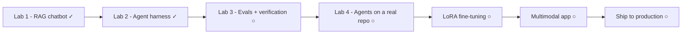

Nếu [Nền tảng]() giải thích các mảnh ghép và
[Building]() trình bày kiến trúc, thì **Giai đoạn 3** là lúc bạn gõ
phím. Mọi lab đều tăng dần: mỗi bước chạy và được kiểm chứng trước khi sang bước sau, vì hệ
thống production thực tế lớn lên đúng như vậy.

## Lộ trình

## Các lab

1. [Lab 1 — RAG chatbot trên tài liệu của chính bạn]() ✓
   — hạ tầng → ingestion → keyword search → hybrid → RAG hoàn chỉnh → monitoring + cache → agentic.
2. [Lab 2 — Tự xây agent harness của riêng bạn]() ✓
   — một lời gọi API → một tool → vòng lặp → quản lý context → subagent → mỗi vai một model →
   permission và hook → MCP và Agent SDK, bước nào cũng đối chiếu với Claude Code.
3. ○ **Lab 3 — eval harness + observability** cho lab 1–2, cộng với **kiểm chứng thứ agent tạo
   ra**: test làm trọng tài, review diff, LLM-as-judge.
4. ○ **Lab 4 — agent trên một repo thật, Level 1 → 3.** Làm cho một repository sẵn sàng cho agent
   (CLAUDE.md, test chạy bằng một lệnh, lint), viết spec và kiểm chứng một task nợ kỹ thuật, chạy
   ba giải pháp song song trong các git worktree và chấm cùng một bộ tiêu chí, rồi điều phối một
   lượt chạy headless và đo trước/sau — bản demo cho đồng nghiệp thấy agent không chỉ là chatbot.
5. ○ **Fine-tuning thực hành (LoRA)** — tinh chỉnh một model nhỏ cho giọng và schema.
6. ○ **App multimodal** — đầu vào vision, trích xuất tài liệu.
7. ○ **Ship to production** — deploy, kiểm soát chi phí, monitoring.

## Yêu cầu trước

Hãy đi hết [mạch]() tương ứng của Giai đoạn 0–2
trước — mạch RAG cho Lab 1, mạch Agents cho Lab 2 và 4. Các lab mặc định bạn đã nắm khái niệm và
chỉ tham chiếu thay vì giải thích lại.
