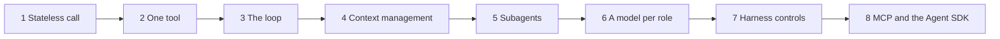

## Mục tiêu

Dùng Claude Code hằng ngày dạy bạn agent làm *gì*. Lab này dạy bạn *vì sao*, bằng cách tự xây
chính cỗ máy đó. Sáu ý tưởng gánh cả lĩnh vực:

- **Tool use**: cách model tác động lên file, terminal và các hệ thống khác.
- **Agentic loop**: suy luận, hành động, quan sát, lặp lại.
- **Quản lý context**: giữ cho window hữu ích khi nó đầy dần.
- **Subagent**: giao phần việc độc lập cho một context mới.
- **Chọn model**: cân năng lực với tốc độ và chi phí.
- **Harness**: runtime, permission và các cơ chế kiểm soát bao quanh tất cả.

Đây không phải sáu chủ đề rời nhau. Chúng là sáu góc nhìn của **một vòng lặp duy nhất**, và
mỗi cái tồn tại vì một vấn đề mà cái trước nó sinh ra:



Bạn xây một file Python duy nhất, `agent.py`, theo đúng thứ tự đó. Cuối cùng nó dài khoảng 200
dòng. Sau mỗi bước, bạn xem **cùng cơ chế đó bên trong Claude Code**, qua chính trace của nó,
để công cụ bạn dùng hằng ngày trở thành thứ bạn đọc hiểu được chứ không còn là hộp đen.

**Yêu cầu trước:**

- Python 3.11+ và một Anthropic API key.
- Đã cài Claude Code.
- Trong một virtual environment: `pip install anthropic "mcp>=2.3" claude-agent-sdk pytest`. Giữ
  nó được kích hoạt để shell của agent cũng tìm thấy `pytest`.
- Các khái niệm trong [mạch Agents](). Lab này
  dẫn link tới phần lý thuyết thay vì nhắc lại.

**Nhịp độ:** mỗi tuần một bước là nhịp tốt, nghĩa là cả lab mất khoảng hai tháng buổi tối.
Mục đích không phải là làm cho xong. Mục đích là cố ý làm hỏng từng bước trước khi đi tiếp.

## Mỗi bước diễn ra thế nào

Mỗi bước là một trang có cùng một khung:

1. **Câu hỏi** ở đầu trang. Đến cuối trang bạn phải trả lời được nó.
2. **Xây dựng**: chỉ phần mới trong `agent.py`.
3. **Kiểm tra**: bạn sẽ thấy gì khi nó chạy đúng.
4. **Xem trong Claude Code**: cùng cơ chế đó hiện ra ở đâu trong công cụ bạn đang dùng.
5. **Làm hỏng nó**: một lỗi cố ý. Phần lớn bài học nằm ở đây.
6. **Đáp án**: tự trả lời trước rồi hãy đọc.

## Dự án mẫu

Agent làm việc trên một dự án tí hon gồm hai file và hai bug:

```python
# sandbox/calc.py
def average(xs):
    return sum(xs) / len(xs) - 1
```

```python
# sandbox/test_calc.py
from calc import average

def test_average():
    assert average([2, 4]) == 3

def test_empty_list_is_zero():
    assert average([]) == 0
```

## Tám bước

| Bước | Bạn xây | Bạn thấy trong Claude Code |
| --- | --- | --- |
| [1 — Một lời gọi stateless]() | Vòng chat trên một danh sách message do bạn giữ | Transcript của session trong `~/.claude/projects/` |
| [2 — Một tool]() | Một vòng `tool_use` → `tool_result` làm bằng tay | `/context` và chi phí của định nghĩa tool |
| [3 — Vòng lặp]() | Bốn tool, gọi song song, lỗi là kết quả, `max_turns` | Log của hook `PostToolUse`; output `stream-json` |
| [4 — Quản lý context]() | Cắt bớt, đọc đúng lúc, `AGENT.md`, caching, compaction | `/context`, `/compact`, CLAUDE.md, `tool-results/` |
| [5 — Subagent]() | `delegate()`: một `run()` mới với ít tool hơn | `.claude/agents/*.md` và transcript trong `subagents/` |
| [6 — Mỗi vai một model]() | Trace và benchmark qua các model và mức effort | `/model` và `model:` trong file subagent |
| [7 — Kiểm soát của harness]() | Luật permission, hook, lưu session | `allow` / `ask` / `deny`, permission mode, `--resume` |
| [8 — Plug-in, và hàng thật]() | Một MCP server, rồi agent trên Agent SDK | `claude mcp add`, `/mcp` |

## Debug mọi agent bằng bốn câu hỏi

Từ giờ, mỗi khi Claude Code hay agent của bạn làm sai, hãy mở trace, tìm lượt **đầu tiên** nó
đi chệch, rồi hỏi theo thứ tự:

1. **Thiếu context?** Nó không biết điều nó cần, hoặc điều đó bị chôn vùi.
   Quay lại [bước 4]().
2. **Tool kém?** Description làm nó hiểu sai, output quá lớn, hoặc lỗi bị nuốt mất.
   Quay lại [bước 2]() và [3]().
3. **Model yếu?** Nó có đủ dữ kiện và tool mà vẫn suy luận tệ. Quay lại [bước 6]().
4. **Harness thiếu ràng buộc?** Nó làm một việc mà lẽ ra nó không bao giờ *có khả năng* làm.
   Quay lại [bước 7]().

Phần lớn các lỗi trông như "model ngốc" hóa ra thuộc hai loại đầu.

## Thiết lập này dừng ở đâu

- **Đây là Level 1**, một agent làm việc cho một người. Chạy nhiều agent trên một codebase thật,
  với việc song song trong các git worktree tách biệt, điều phối và review, là **Lab 4**.
- **Ở đây chưa có gì kiểm tra rằng output là *tốt*.** Test pass là một tín hiệu. Đánh giá thứ
  agent tạo ra là **Lab 3**.
- **Permission bằng regex không phải là sandbox.** Với bất cứ thứ gì không do chính bạn viết,
  hãy chạy agent trong một container không có credential.
- Trong production, bạn sẽ dùng compaction và context editing phía server của nền tảng thay vì
  `compact()`. Tự tay xây `compact()` là cách để hiểu chúng làm gì.

## Nguồn

- [Anthropic — Building effective agents](https://www.anthropic.com/research/building-effective-agents)
- [Anthropic — Effective context engineering for AI agents](https://www.anthropic.com/engineering/effective-context-engineering-for-ai-agents)
- [Anthropic — Writing effective tools for AI agents, using AI agents](https://www.anthropic.com/engineering/writing-tools-for-agents)
- [Anthropic — How we built our multi-agent research system](https://www.anthropic.com/engineering/multi-agent-research-system)
- [Anthropic — Building agents with the Claude Agent SDK](https://www.anthropic.com/engineering/building-agents-with-the-claude-agent-sdk)
- [Anthropic — Effective harnesses for long-running agents](https://www.anthropic.com/engineering/effective-harnesses-for-long-running-agents)
- Thorsten Ball, [How to Build an Agent](https://ampcode.com/how-to-build-an-agent) (Amp) · [mini-swe-agent](https://github.com/SWE-agent/mini-swe-agent)
- Liu et al., *Lost in the Middle: How Language Models Use Long Contexts* (2023) — [arXiv:2307.03172](https://arxiv.org/abs/2307.03172)
- [Chroma — Context Rot](https://research.trychroma.com/context-rot) · [Cognition — Don't Build Multi-Agents](https://cognition.ai/blog/dont-build-multi-agents)
- Tài liệu Claude API: [Tool use](https://platform.claude.com/docs/en/agents-and-tools/tool-use/overview) · [Prompt caching](https://platform.claude.com/docs/en/build-with-claude/prompt-caching) · [Compaction](https://platform.claude.com/docs/en/build-with-claude/compaction)
- Tài liệu Claude Code: [Sessions](https://code.claude.com/docs/en/sessions) · [The .claude directory](https://code.claude.com/docs/en/claude-directory) · [Hooks](https://code.claude.com/docs/en/hooks) · [Subagents](https://code.claude.com/docs/en/sub-agents) · [Permissions](https://code.claude.com/docs/en/permissions) · [Headless mode](https://code.claude.com/docs/en/headless) · [MCP](https://code.claude.com/docs/en/mcp) · [Agent SDK for Python](https://code.claude.com/docs/en/agent-sdk/python)
- [MCP Python SDK](https://github.com/modelcontextprotocol/python-sdk)
