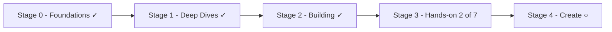

Vault này là một **bản đồ sống**, không phải cuốn sách đã đóng bìa. Mục tiêu là đi xa hơn
việc *dùng* ChatGPT hay Claude: **hiểu** các hệ thống này hoạt động ra sao, **thuần thục**
những kỹ thuật quan trọng, **xây** hệ thống thật, và cuối cùng **ship** các dự án hands-on.
Trang đã viết đánh dấu ✓; trang dự định ○ — học tới đâu điền vào tới đó.

## Hành trình

Đọc **theo hàng ngang** để tiến từng giai đoạn, hoặc chọn một hàng trong
[bảng chủ đề](#đào-sâu-một-chủ-đề) bên dưới để đào sâu một mạch kiến thức. Để kiểm tra mình
thực sự *làm được* gì, dùng [bảng kiểm 25 kỹ năng](#bảng-kiểm-25-kỹ-năng).

## Giai đoạn 0 — Nền tảng ✓

28 khái niệm trong [năm module có thứ tự](), từ *mô hình là gì*
đến *vận hành chúng trên production*:

1. **Understand** — bức tranh AI, generative AI, foundation model, LLM hoạt động ra sao,
   huấn luyện, multimodality, giới hạn.
2. **Work with a model** — API, tham số, prompting, context, structured outputs, reasoning
   model, chi phí, chọn model.
3. **Ground it in your data** — embeddings, RAG.
4. **Make it act** — tools, agents, agentic AI, MCP, AI coding assistants.
5. **Operate & govern** — guardrails, security, đánh giá, observability, responsible AI.

## Giai đoạn 1 — Deep Dives ✓

[Mười hai bài đào sâu]() theo cùng trục xương sống:
[prompt patterns]() ·
[vector databases]() ·
[types of RAG]() ·
[advanced RAG]() ·
[agent patterns]() ·
[agent memory]() ·
[multi-agent systems]() ·
[self-improving agents]() ·
[computer use]() ·
[adaptation]() ·
[evaluation in practice]() ·
[RAG evaluation]().

## Giai đoạn 2 — Building with AI ✓

[Mười mục]() lắp ráp các mảnh ghép:
[AI system design]() ·
[scaling to production]() ·
[serving models]() ·
[building RAG]() ·
[agentic RAG]() ·
[the agent harness]() ·
[loop engineering]() ·
[from prompts to graphs]() ·
[AI code structure]() ·
[tooling & frameworks]().

## Giai đoạn 3 — Hands-on (đang tiến hành)

[Dự án thật](), xây tăng dần:

1. ✓ **[Lab: RAG chatbot trên tài liệu của chính mình]()**
   — theo bảy bước: hạ tầng → ingestion → keyword search → hybrid search → RAG hoàn chỉnh →
   monitoring + caching → nâng cấp agentic.
2. ✓ **[Lab: tự xây agent harness của riêng bạn]()** — theo tám bước: một lời gọi API →
   một tool → vòng lặp → quản lý context → subagent → mỗi vai một model → permission và hook →
   MCP và Agent SDK, bước nào cũng đối chiếu với Claude Code.
3. ○ **Lab: eval harness + observability** cho lab 1–2, cộng với kiểm chứng thứ agent tạo ra.
4. ○ **Lab: agent trên một repo thật, Level 1 → 3** — repo sẵn sàng cho agent, spec và kiểm
   chứng, các giải pháp song song trong git worktree, điều phối, đo trước/sau.
5. ○ **Fine-tuning thực hành (LoRA)** — tinh chỉnh một model nhỏ cho giọng và schema.
6. ○ **App multimodal** — đầu vào vision, trích xuất tài liệu.
7. ○ **Ship to production** — deploy, kiểm soát chi phí, monitoring.

## Giai đoạn 4 — Create ○ (dự định, xa hơn)

- ○ AI product design — từ năng lực đến sản phẩm.
- ○ Kinh tế học của thử nghiệm — từ *"ta có đủ người và thời gian để xây cái này không?"* sang
  *"ta có thể chạy một thử nghiệm để biết nó có đáng xây không?"* Thử nghiệm rẻ vẫn cần giả
  thuyết, chỉ số thành công, điều kiện dừng và ngân sách **trước khi** giao việc, vì nhiều đầu
  ra hơn không có nghĩa là nhiều giá trị hơn.
- ○ Case study các sản phẩm AI thật.
- ○ Ghi chú chứng chỉ & bảng ôn tập.

## Đào sâu một chủ đề

Mỗi hàng là một mạch kiến thức xuyên các giai đoạn — cách đọc vault theo chiều dọc:

| Chủ đề | Giai đoạn 0 | Giai đoạn 1 | Giai đoạn 2 | Giai đoạn 3 ○ |
| ------ | ------ | ------ | ------ | ------ |
| **Prompts** | [Prompt engineering]() · [Context engineering]() | [Prompt patterns]() | — | — |
| **Data & RAG** | [Embeddings]() · [RAG]() | [Vector databases]() · [Types of RAG]() · [Advanced RAG]() · [RAG evaluation]() | [Building RAG]() · [Agentic RAG]() | [Lab RAG chatbot ✓]() |
| **Agents** | [Tool calling]() · [Agents]() · [Agentic AI]() · [MCP]() | [Agent patterns]() · [Agent memory]() · [Multi-agent]() · [Self-improving]() · [Computer use]() | [Agent harness]() · [Loop engineering]() · [AI code structure]() | [Lab agent harness ✓]() · ○ Lab repo thật |
| **Operate** | [Guardrails]() · [AI security]() · [Đánh giá]() · [Observability]() · [Responsible AI]() | [Adaptation]() · [Evaluation in practice]() · [RAG evaluation]() | [AI system design]() · [Scaling to production]() · [Tooling & frameworks]() | ○ Lab evals + ship |
| **Serving & inference** | [The AI API]() · [Cost & tokens]() · [Choosing a model]() | [Adaptation]() | [Scaling to production]() · [Serving models]() | ○ Lab ship to production |

## Agent engineering — bốn tầng

Mở Claude Code, viết prompt hay thêm một file skill không đồng nghĩa với hiểu agent. Kỹ năng này
xếp thành bốn tầng, và tầng nào cũng cần tầng bên dưới nó:

| Tầng | Câu hỏi nó trả lời | Trong vault |
| --- | --- | --- |
| **Cơ chế** | Agent hoạt động thế nào? Quản lý context, tool use, subagent, chọn model, vòng lặp, harness. | [Mạch Agents](#đào-sâu-một-chủ-đề) · [Lab 2 ✓]() |
| **Tay nghề** | Làm sao có kết quả *đáng tin*? Repo sẵn sàng cho agent, spec rõ ràng, và kiểm chứng đầu ra. | ○ Lab 3 · ○ Lab 4 |
| **Mở rộng** | Làm sao đi từ một agent lên nhiều agent? Level 1 một agent → Level 2 các subagent song song → Level 3 một orchestrator trong khi bạn giữ mục tiêu và quyết định. | [Multi-agent]() · [Fleet looping]() · ○ Lab 4 |
| **Phán đoán** | Cái gì đáng xây, và nó có hiệu quả không? Thử nghiệm có mục tiêu, và bằng chứng mà đồng nghiệp kiểm tra được. | ○ Giai đoạn 4 |

**Kiểm chứng** chạy xuyên qua cả bốn tầng. Agent nhanh hơn chỉ có ích khi bạn phân biệt được đầu
ra tốt với đầu ra tồi. Thang Level 1 → 3 đo **chiều rộng**: bao nhiêu agent, và ai điều phối
chúng. [The Four Levels of Loops]() đo
**chiều sâu**: thứ gì bọc quanh mỗi vòng lặp. Đó là hai trục khác nhau, và một hệ thống thật có
vị trí trên cả hai.

## Bảng kiểm 25 kỹ năng

Các giai đoạn và mạch chủ đề sắp xếp những gì **đã viết**. Bảng này sắp xếp những gì bạn cần
**làm được**. Nó lấy một lộ trình ba cấp quen thuộc dành cho người xây agent (25 kỹ năng, từ
GenAI cơ bản đến deploy một agent) và gắn cho mỗi kỹ năng ba thứ: các trang giải thích nó, bước
lab nơi bạn tự xây nó, và một bài kiểm tra bạn tự chấm được.

Một kỹ năng chỉ tính là xong khi hàng của nó không còn ○ **và** bạn qua được bài kiểm tra ở cột
cuối. Đọc xong trang thì chưa đủ.

### Level 1 — GenAI và RAG cơ bản

| # | Kỹ năng | Hiểu | Làm | Làm được khi… |
| --- | --- | --- | --- | --- |
| 1 | **GenAI cơ bản** | [The AI landscape]() · [Generative AI]() · [Limitations]() | — | Bạn nói được cho đồng nghiệp generative AI giỏi việc gì, và kể được ba kiểu nó sai. |
| 2 | **LLM hoạt động ra sao** | [How LLMs work]() · [How models are trained]() · [Under the hood]() | [Lab 2, bước 1 ✓]() | Bạn giải thích được token là gì, và vì sao model không nhớ gì giữa hai lời gọi API. |
| 3 | **Prompt engineering** | [Prompt engineering]() · [Context engineering]() · [Prompt patterns]() | [Lab 1, bước 5 ✓]() | Bạn viết được một prompt bám nguồn: câu trả lời trích dẫn context, và nói rõ khi context không có câu trả lời. |
| 4 | **Tham số model** | [Inference parameters]() · [Reasoning models]() · [Cost & tokens]() | [Lab 2, bước 6 ✓]() | Bạn đoán trước được một lần chạy đổi thế nào khi chỉnh `max_tokens`, temperature hay effort, rồi kiểm lại bằng số đo. |
| 5 | **Chuẩn bị dữ liệu** | [Building RAG]() · [Advanced RAG]() | [Lab 1, bước 2 ✓]() (chỉ văn bản thuần) · ○ một bước với PDF và HTML thật: làm sạch, khử trùng lặp, so sánh cách chunk | Bạn biến được một thư mục PDF và HTML lộn xộn thành các chunk sạch kèm metadata, và chỉ ra cách chunk nào truy xuất tốt hơn. |
| 6 | **RAG cơ bản** | [Embeddings]() · [RAG]() · [Types of RAG]() | [Lab 1, bước 3–5 ✓]() | Pipeline của bạn trả lời từ tài liệu của chính bạn, có trích dẫn, và từ chối khi tài liệu không có câu trả lời. |
| 7 | **Vector database** | [Vector databases]() | [Lab 1, bước 1 và 4 ✓]() | Bạn lưu và tìm được embedding, nói được ANN index đánh đổi điều gì, và khi nào pgvector không còn đủ. |
| 8 | **LLM framework** | ○ LangChain và LlamaIndex trong [Tooling & frameworks]() | ○ bước 5 của Lab 1 dựng lại bằng một framework | Bạn dựng lại được pipeline RAG bằng một framework và chỉ ra mỗi lớp trừu tượng thay cho đoạn code nào của mình. |
| 9 | **Tool calling** | [Tool & function calling]() · [Structured outputs]() | [Lab 2, bước 2 ✓]() | Bạn tự tay chạy được một vòng `tool_use` → `tool_result`, và nói được ai mới là bên thực thi tool. |

### Level 2 — Thiết yếu về AI agent

| # | Kỹ năng | Hiểu | Làm | Làm được khi… |
| --- | --- | --- | --- | --- |
| 10 | **Agent là gì** | [Agents]() · [Agentic AI]() · [AI coding assistants]() | [Lab 2, bước 3 ✓]() | Bạn phân biệt được workflow cố định với agent, và nêu được một việc mà agent là lựa chọn sai. |
| 11 | **Agent framework** | [Tooling & frameworks]() · [From prompts to graphs]() · ○ bảng so sánh LangGraph, CrewAI, Agno và SDK của các hãng | [Lab 2, bước 8 ✓]() (Claude Agent SDK) · ○ cùng agent đó viết bằng LangGraph và một framework nữa | Bạn chuyển được `agent.py` sang một framework và liệt kê được nó cho bạn gì, che mất gì. |
| 12 | **Agent đầu tiên** | [The agent harness]() | [Lab 2, bước 1–3 ✓]() | Vòng lặp do bạn viết tự sửa được một test đang fail trong project sandbox mà không cần bạn giúp. |
| 13 | **Agent flow** | [Agent patterns]() · [Loop engineering]() · [From prompts to graphs]() | [Lab 1, bước 7 ✓]() · [Lab 2, bước 3 ✓]() | Bạn vẽ được chỗ agent suy luận, hành động, kiểm tra và dừng, và chọn được giữa pipeline và loop cho một việc. |
| 14 | **Agent memory** | [Agent memory]() | [Lab 2, bước 4 ✓]() · [bước 7 ✓]() (context, `AGENT.md`, session) · ○ memory dài hạn do agent tự ghi và tự truy xuất | Agent của bạn nhớ lại được một điều từ phiên làm việc tuần trước, và bạn gọi tên được loại memory đã giữ nó. |
| 15 | **Đánh giá agent** | [Model evaluation]() · [Evaluation in practice]() · ○ đánh giá agent: trajectory, tool call, tỉ lệ hoàn thành task | ○ Lab 3 | Bạn có một bộ task kèm grader, và nêu được tỉ lệ pass, chi phí và độ trễ của agent trước và sau một thay đổi. |
| 16 | **Suy luận nhiều bước** | [Reasoning models]() · [Prompt patterns]() | [Lab 2, bước 6 ✓]() | Bạn chứng minh được bằng benchmark khi nào tăng reasoning effort là đáng tiền, và khi nào không. |
| 17 | **Hệ multi-agent** | [Multi-agent]() · [Fleet looping]() | [Lab 2, bước 5 ✓]() · ○ Lab 4 | Bạn chia được một việc cho orchestrator và các subagent, và chỉ ra nó có thắng một agent đơn hay không. |
| 18 | **Agentic RAG** | [Agentic RAG]() · [Self-correcting RAG]() | [Lab 1, bước 7 ✓]() | Một câu hỏi multi-hop cho thấy hai lượt tìm khác nhau trong trace, còn "hello" thì không có lượt nào. |
| 19 | **Lập kế hoạch hành động** | [Agent patterns]() · [Cấu tạo của loop]() | [Lab 2, bước 3 ✓]() (lỗi trả về như result) · ○ một kế hoạch do agent tự viết và tự sửa | Agent của bạn viết kế hoạch, gặp một bước thất bại, sửa kế hoạch rồi làm xong, và trace cho thấy từng lần sửa. |
| 20 | **An toàn và guardrail** | [Guardrails]() · [AI security]() · [Responsible AI]() | [Lab 2, bước 7 ✓]() (permission, hook) · ○ guardrail cho input và output, và một bài test prompt injection | Bạn cho thấy được một chỉ dẫn cài trong tool result bị chặn bằng code chứ không phải bằng prompt. |

### Level 3 — Kỹ năng agent nâng cao

| # | Kỹ năng | Hiểu | Làm | Làm được khi… |
| --- | --- | --- | --- | --- |
| 21 | **Tích hợp thực tế** | [MCP]() · [Tooling & frameworks]() | [Lab 2, bước 8 ✓]() (server cục bộ) · ○ một server remote thật như Slack, Notion hay Gmail, qua OAuth | Agent của bạn đọc và ghi được trong một workspace thật qua MCP, với quyền truy cập thu hẹp theo đúng việc. |
| 22 | **Vòng lặp tự hành** | [Loop engineering]() · [Self-improving agents]() | ○ một agent chạy theo lịch mà không ai ngồi canh · ○ Lab 4 | Agent chạy theo trigger, tự dừng theo điều kiện của nó, và để lại log mà bạn tin được. |
| 23 | **Bộ tool tự viết** | [Tool & function calling]() · [Agent patterns]() | [Lab 2, bước 2 ✓]() · [bước 3 ✓]() · [bước 8 ✓]() (MCP server của riêng bạn) · ○ một tool bọc một HTTP API thật | Bạn bọc được một API thành tool, có auth, phân trang và lỗi trả về như result, và model dùng đúng chỉ nhờ phần mô tả. |
| 24 | **Tối ưu hiệu năng** | [Cost & tokens]() · [Scaling to production]() · [Routing & fallback]() | [Lab 1, bước 6 ✓]() · [Lab 2, bước 4 ✓]() · [bước 6 ✓]() · ○ Lab 3, để có tỉ lệ pass | Bạn giảm được chi phí hoặc độ trễ của một lần chạy một lượng đo được mà không làm tụt tỉ lệ pass. |
| 25 | **Deploy lên production** | [AI system design]() · [Scaling to production]() · [Observability]() · ○ deploy một agent: session, state, sandbox, giới hạn | ○ Lab 7 | Một người khác dùng agent của bạn qua một URL, có session riêng, có trần chi tiêu, và có trace để bạn đọc. |

### Các ô ○ thêm gì vào kế hoạch

Các ô ○ là phần việc còn nợ. Theo thứ tự dự định làm:

1. **Lab 3 trở thành lab đánh giá agent** (kỹ năng 15 và 24). Làm trước tiên, để mọi bước sau
   đều có một con số để cải thiện.
2. **Một lab mới: agent làm việc thật** (kỹ năng 14, 19, 20, 21, 22 và 23). Lab này tiếp nối
   `agent.py` của Lab 2 qua sáu bước: tool gọi một API thật → kế hoạch tự sửa được → memory dài
   hạn → một MCP server thật → guardrail và bài test injection → chạy theo lịch.
3. **Một lượt framework** (kỹ năng 8 và 11). Cùng pipeline RAG và cùng agent đó, dựng lại bằng
   framework rồi so với bản tự viết.
4. **Một bước chuẩn bị dữ liệu trong Lab 1** (kỹ năng 5).
5. **Lab 7 mở ra thành các bước deploy** (kỹ năng 25).
