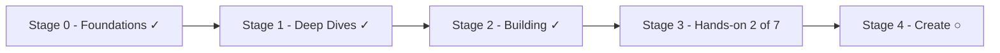

Vault này là một **bản đồ sống**, không phải cuốn sách đã đóng bìa. Mục tiêu là đi xa hơn
việc *dùng* ChatGPT hay Claude: **hiểu** các hệ thống này hoạt động ra sao, **thuần thục**
những kỹ thuật quan trọng, **xây** hệ thống thật, và cuối cùng **ship** các dự án hands-on.
Trang đã viết đánh dấu ✓; trang dự định ○ — học tới đâu điền vào tới đó.

## Hành trình

Đọc **theo hàng ngang** để tiến từng giai đoạn, hoặc chọn một hàng trong
[bảng chủ đề](#đào-sâu-một-chủ-đề) bên dưới để đào sâu một mạch kiến thức.

## Giai đoạn 0 — Nền tảng ✓

28 khái niệm trong [năm module có thứ tự](), từ *mô hình là gì*
đến *vận hành chúng trên production*:

1. **Understand** — bức tranh AI, generative AI, foundation model, LLM hoạt động ra sao,
   huấn luyện, multimodality, giới hạn.
2. **Work with a model** — API, tham số, prompting, context, structured outputs, reasoning
   model, chi phí, chọn model.
3. **Ground it in your data** — embeddings, RAG.
4. **Make it act** — tools, agents, agentic AI, MCP, AI coding assistants.
5. **Operate & govern** — guardrails, security, đánh giá, observability, responsible AI.

## Giai đoạn 1 — Deep Dives ✓

[Mười hai bài đào sâu]() theo cùng trục xương sống:
[prompt patterns]() ·
[vector databases]() ·
[types of RAG]() ·
[advanced RAG]() ·
[agent patterns]() ·
[agent memory]() ·
[multi-agent systems]() ·
[self-improving agents]() ·
[computer use]() ·
[adaptation]() ·
[evaluation in practice]() ·
[RAG evaluation]().

## Giai đoạn 2 — Building with AI ✓

[Mười mục]() lắp ráp các mảnh ghép:
[AI system design]() ·
[scaling to production]() ·
[serving models]() ·
[building RAG]() ·
[agentic RAG]() ·
[the agent harness]() ·
[loop engineering]() ·
[from prompts to graphs]() ·
[AI code structure]() ·
[tooling & frameworks]().

## Giai đoạn 3 — Hands-on (đang tiến hành)

[Dự án thật](), xây tăng dần:

1. ✓ **[Lab: RAG chatbot trên tài liệu của chính mình]()**
   — theo bảy bước: hạ tầng → ingestion → keyword search → hybrid search → RAG hoàn chỉnh →
   monitoring + caching → nâng cấp agentic.
2. ✓ **[Lab: tự xây agent harness của riêng bạn]()** — theo tám bước: một lời gọi API →
   một tool → vòng lặp → quản lý context → subagent → mỗi vai một model → permission và hook →
   MCP và Agent SDK, bước nào cũng đối chiếu với Claude Code.
3. ○ **Lab: eval harness + observability** cho lab 1–2, cộng với kiểm chứng thứ agent tạo ra.
4. ○ **Lab: agent trên một repo thật, Level 1 → 3** — repo sẵn sàng cho agent, spec và kiểm
   chứng, các giải pháp song song trong git worktree, điều phối, đo trước/sau.
5. ○ **Fine-tuning thực hành (LoRA)** — tinh chỉnh một model nhỏ cho giọng và schema.
6. ○ **App multimodal** — đầu vào vision, trích xuất tài liệu.
7. ○ **Ship to production** — deploy, kiểm soát chi phí, monitoring.

## Giai đoạn 4 — Create ○ (dự định, xa hơn)

- ○ AI product design — từ năng lực đến sản phẩm.
- ○ Kinh tế học của thử nghiệm — từ *"ta có đủ người và thời gian để xây cái này không?"* sang
  *"ta có thể chạy một thử nghiệm để biết nó có đáng xây không?"* Thử nghiệm rẻ vẫn cần giả
  thuyết, chỉ số thành công, điều kiện dừng và ngân sách **trước khi** giao việc, vì nhiều đầu
  ra hơn không có nghĩa là nhiều giá trị hơn.
- ○ Case study các sản phẩm AI thật.
- ○ Ghi chú chứng chỉ & bảng ôn tập.

## Đào sâu một chủ đề

Mỗi hàng là một mạch kiến thức xuyên các giai đoạn — cách đọc vault theo chiều dọc:

| Chủ đề | Giai đoạn 0 | Giai đoạn 1 | Giai đoạn 2 | Giai đoạn 3 ○ |
| ------ | ------ | ------ | ------ | ------ |
| **Prompts** | [Prompt engineering]() · [Context engineering]() | [Prompt patterns]() | — | — |
| **Data & RAG** | [Embeddings]() · [RAG]() | [Vector databases]() · [Types of RAG]() · [Advanced RAG]() · [RAG evaluation]() | [Building RAG]() · [Agentic RAG]() | [Lab RAG chatbot ✓]() |
| **Agents** | [Tool calling]() · [Agents]() · [Agentic AI]() · [MCP]() | [Agent patterns]() · [Agent memory]() · [Multi-agent]() · [Self-improving]() · [Computer use]() | [Agent harness]() · [Loop engineering]() · [AI code structure]() | [Lab agent harness ✓]() · ○ Lab repo thật |
| **Operate** | [Guardrails]() · [AI security]() · [Đánh giá]() · [Observability]() · [Responsible AI]() | [Adaptation]() · [Evaluation in practice]() · [RAG evaluation]() | [AI system design]() · [Scaling to production]() · [Tooling & frameworks]() | ○ Lab evals + ship |
| **Serving & inference** | [The AI API]() · [Cost & tokens]() · [Choosing a model]() | [Adaptation]() | [Scaling to production]() · [Serving models]() | ○ Lab ship to production |

## Agent engineering — bốn tầng

Mở Claude Code, viết prompt hay thêm một file skill không đồng nghĩa với hiểu agent. Kỹ năng này
xếp thành bốn tầng, và tầng nào cũng cần tầng bên dưới nó:

| Tầng | Câu hỏi nó trả lời | Trong vault |
| --- | --- | --- |
| **Cơ chế** | Agent hoạt động thế nào? Quản lý context, tool use, subagent, chọn model, vòng lặp, harness. | [Mạch Agents](#đào-sâu-một-chủ-đề) · [Lab 2 ✓]() |
| **Tay nghề** | Làm sao có kết quả *đáng tin*? Repo sẵn sàng cho agent, spec rõ ràng, và kiểm chứng đầu ra. | ○ Lab 3 · ○ Lab 4 |
| **Mở rộng** | Làm sao đi từ một agent lên nhiều agent? Level 1 một agent → Level 2 các subagent song song → Level 3 một orchestrator trong khi bạn giữ mục tiêu và quyết định. | [Multi-agent]() · [Fleet looping]() · ○ Lab 4 |
| **Phán đoán** | Cái gì đáng xây, và nó có hiệu quả không? Thử nghiệm có mục tiêu, và bằng chứng mà đồng nghiệp kiểm tra được. | ○ Giai đoạn 4 |

**Kiểm chứng** chạy xuyên qua cả bốn tầng. Agent nhanh hơn chỉ có ích khi bạn phân biệt được đầu
ra tốt với đầu ra tồi. Thang Level 1 → 3 đo **chiều rộng**: bao nhiêu agent, và ai điều phối
chúng. [The Four Levels of Loops]() đo
**chiều sâu**: thứ gì bọc quanh mỗi vòng lặp. Đó là hai trục khác nhau, và một hệ thống thật có
vị trí trên cả hai.
